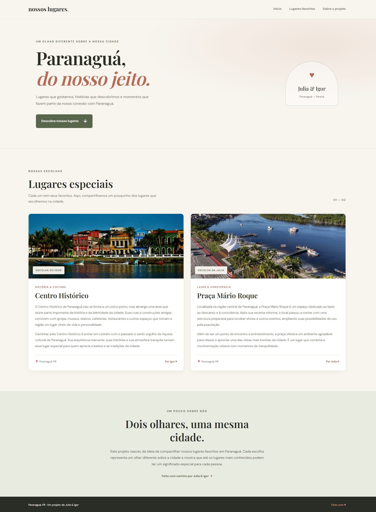

# Lugares Favoritos de Paranaguá | Favorite Places in Paranaguá

Projeto acadêmico desenvolvido para apresentar dois lugares especiais de Paranaguá, Paraná, por meio de uma página web.

An academic web project showcasing two special places in Paranaguá, Paraná, Brazil, through a web page.



## Sobre o projeto | About the Project

O site apresenta duas escolhas — Centro Histórico e Praça Mário Roque — em uma experiência visual com navegação por seções, imagens e descrições.

The website features two selected locations — the Historic Center and Mário Roque Square — through a visual experience with section navigation, images, and descriptions.

## Tecnologias | Technologies

- HTML5
- CSS3
- Google Fonts — DM Sans e Playfair Display

## Funcionalidades | Features

- Navegação entre as seções da página;
- Apresentação dos lugares em cartões;
- Layout responsivo para telas menores;
- Imagens com texto alternativo;
- Seção sobre a proposta do projeto.

- Navigation between page sections;
- Location presentation through cards;
- Responsive layout for smaller screens;
- Images with alternative text;
- A section explaining the project's purpose.

## Executar localmente | Run Locally

1. Clone o repositório | Clone the repository:

   ```bash
   git clone https://github.com/igorgustavofernandes/lugares-favoritos-paranagua.git
   ```

2. Abra a pasta do projeto | Open the project folder.
3. Abra o arquivo `index.html` no navegador | Open `index.html` in your browser.

Não é necessário instalar dependências ou executar um servidor para visualizar a página.

No dependencies or server setup are required to view the page.

## Estrutura | Structure

```text
lugares-favoritos-paranagua/
├── index.html
├── style.css
└── imagens/
    ├── paranagua.jpg
    ├── praca-mario-roque-paranagua.jpg
    └── preview.png
```

## Sobre o desenvolvimento | Development Notes

Projeto acadêmico desenvolvido majoritariamente por Igor, com apoio de ferramentas de IA durante parte do processo. A proposta foi praticar estruturação HTML, estilização CSS e organização de uma página com conteúdo visual.

An academic project primarily developed by Igor, with AI tools supporting part of the process. Its purpose was to practice HTML structure, CSS styling, and the organization of a visually oriented web page.

---

*Um exercício de desenvolvimento web e apresentação visual de lugares da minha cidade.*

*A web development exercise focused on visual presentation and places from my hometown.*
